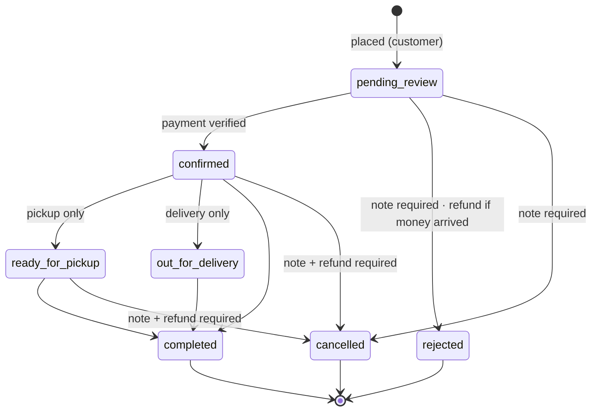

# Order Lifecycle

The order state machine. The authoritative copy is the `orders.order_status_transitions` table. This file explains it; if they disagree, the table wins, so fix this file.

## Transitions

| From                                                | To                 | Note                         | Only for | Payment effect                                                     | Stock effect | Customer email |
| --------------------------------------------------- | ------------------ | ---------------------------- | -------- | ------------------------------------------------------------------ | ------------ | -------------- |
| —                                                   | `pending_review`   | —                            | —        | payment `submitted`                                                | reserve      | —              |
| `pending_review`                                    | `confirmed`        | optional (shown to customer) | —        | → `verified`                                                       | —            | confirmed      |
| `pending_review`                                    | `rejected`         | **required**                 | —        | → `rejected`, or `verified` + refund if a refund proof is attached | release      | rejected       |
| `pending_review`                                    | `cancelled`        | **required**                 | —        | → `rejected`                                                       | release      | cancelled      |
| `confirmed`                                         | `ready_for_pickup` | —                            | pickup   | —                                                                  | —            | —              |
| `confirmed`                                         | `out_for_delivery` | —                            | delivery | —                                                                  | —            | —              |
| `confirmed`, `ready_for_pickup`, `out_for_delivery` | `completed`        | —                            | —        | —                                                                  | —            | —              |
| `confirmed`, `ready_for_pickup`                     | `cancelled`        | **required**                 | —        | refund **required** (full)                                         | release      | cancelled      |

Subscribed admins are notified on Telegram: new orders arrive with Confirmar / Rechazar buttons, and every decision edits the earlier alerts (filtered by their subscriptions, brand filters and pause setting). Decisions can be made from the web admin or the Telegram bot; both go through the `orders.transition` capability.

## Rules

- **Placed ≠ confirmed.** Registering an order never means payment was accepted (product principle).
- Terminal states: `completed`, `rejected`, `cancelled`. Nothing leaves them.
- Orders are never edited (DOM-04). To change an order: cancel it, and the customer places a new one.
- Refunds are full-amount only (DOM-06), at most one per payment.
- Every transition appends an `order_events` row with actor, source (`admin_web` | `messaging` | `system`) and note.
- Re-requesting the current state is a no-op, which makes double clicks and Telegram retries safe.
