# ER Design

The target database for the rebuild. Decisions are cited by ID from [01-decisions.md](01-decisions.md). This document is the spec that `supabase/schemas/**` gets written from. If they disagree, fix one of them in the same PR.

## 1. Conventions

| Rule | Example | Ref |
|---|---|---|
| One schema per feature that owns data; the schema name = the feature folder name in `snake_case` | `catalog.products` ↔ `src/features/catalog`, `admin_chat` ↔ `admin-chat` | DB-01 |
| `snake_case`, plural tables, singular columns | `order_items.unit_price` | DB-02 |
| PK `id uuid default private.uuid_v7()`. Exceptions: 1:1 child tables use the parent's id; singletons use `id boolean`. | | DB-03 |
| FK = `<entity>_id`, **always indexed** | `order_items.order_id` + `order_items_order_id_idx` | DB-02 |
| Timestamps `timestamptz`, named `<verb>_at` | `placed_at`, `archived_at` | DB-02 |
| Booleans `is_` / `has_` | `is_primary`, `is_stock_tracked` | DB-02 |
| Money: `amount_crc` domain = `integer check (value >= 0)`, whole colones | `unit_price amount_crc` | DB-04 |
| Closed sets = enums in the owning schema | `orders.order_status` | DB-05 |
| Every table has `created_at`, `updated_at` (trigger `private.set_updated_at`) | | DB-06 |
| Admin-edited tables add `created_by`, `updated_by` → `access.admins` | | DB-06 |
| Catalog/config rows are archived (`archived_at`), never deleted | | DB-07 |
| Constraint names `<table>_<cols>_<kind>` (`_key`, `_check`, `_fkey`); indexes `<table>_<cols>_idx` | `products_brand_id_slug_key` | DB-02 |
| Text has length checks at the DB level, not just in Zod | `check (char_length(name) between 1 and 120)` | |
| SQL is formatted for reading: lowercase keywords, one column per line, blank line between statements | see [§13](#13-sql-style) | AG-02 |

`private.uuid_v7()` wraps the native `uuidv7()` on Postgres 18+, or a SQL implementation on 17. Defining it once lets us switch implementations without touching tables.

**Reading the diagrams.** Each diagram shows one schema with its columns. Tables from other schemas appear with only their `id`, so the relationship is visible. To keep the diagrams short, the standard columns are omitted: `created_at`, `updated_at` on every table, and `created_by`, `updated_by` on tables marked *(admin-edited)*.

## 2. Schema map

| Schema | Owns | Exposed to PostgREST | Feature |
|---|---|---|---|
| `access` | admins, roles, permission map | yes (RLS) | `access` |
| `media` | file metadata (objects live in Storage) | yes (RLS) | `media` |
| `catalog` | brands, categories, products, variants, price history | yes (RLS) | `catalog` |
| `retail` | points of sale: third-party stores where Snackyzz is sold | yes (RLS) | `retail` |
| `fulfillment` | Snackyzz pickup locations, their hours, delivery zones, delivery hours, settings | yes (RLS) | `fulfillment` |
| `inventory` | stock levels (global + optional per pickup location), stock movements | yes (RLS) | `inventory` |
| `orders` | customers, orders, items, pickups, deliveries, payments, refunds, events, transitions, settings | yes (RLS) | `orders` |
| `events` | domain events (app-wide outbox), consumer receipts | yes, **service_role only** | `events` |
| `messaging` | linked chat identities, link tokens, outbound queue, inbound inbox | yes, **service_role only** | `messaging` |
| `notifications` | notification types, subscriptions, pause settings | yes (RLS: admins manage their own) | `notifications` |
| `admin_chat` | chat conversations (flow state), command log | yes, **service_role only** | `admin-chat` |
| `themes` | themes, active theme | yes (RLS) | `themes` |
| `reporting` | read-only report functions (no tables) | yes (functions only) | `reporting` |
| `private` | helpers: `uuid_v7`, `set_updated_at`, `has_permission`, `publish_event`, `apply_stock_movement`, `transition_order` | **no** | — |

Rule: a `security definer` function lives in `private` unless it's the intended API entry point. Entry points are granted `execute` to exactly the roles that call them, after `revoke execute ... from public`.

## 3. Overview

How the schemas relate. Detailed columns follow per schema.

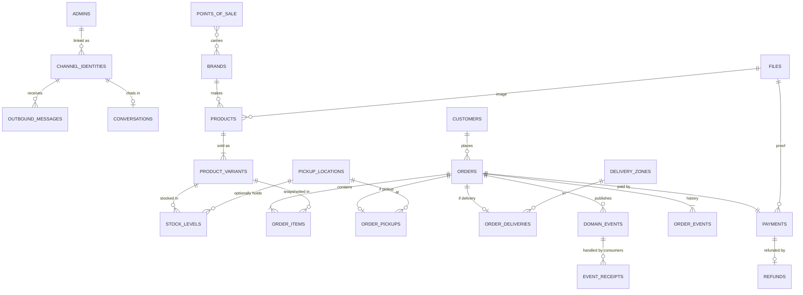

`POINTS_OF_SALE` (retail) and `PICKUP_LOCATIONS` (fulfillment) are **different concepts**:

| | Point of sale (`retail.points_of_sale`) | Pickup location (`fulfillment.pickup_locations`) |
|---|---|---|
| Who runs it | A third party: local store, supermarket, café… | Snackyzz |
| What customers do there | Buy Snackyzz products off the shelf | Collect an order placed online |
| Used in checkout | No | Yes |
| Stock tracked by us | No | Optionally (otherwise orders use global stock) |
| Shown publicly | "Where to buy" page | Checkout, plus a section of the "Where to buy" page |

## 4. Access & media

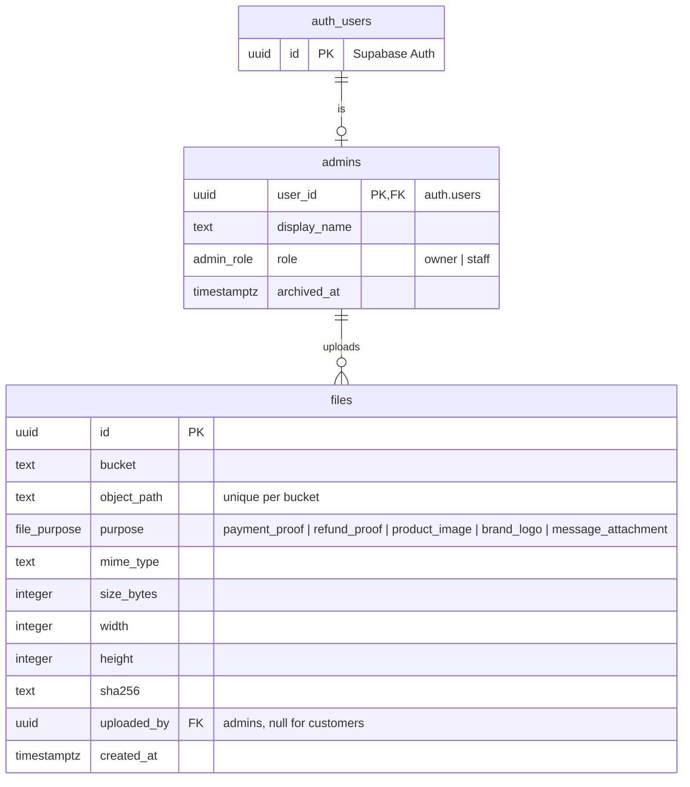

*(admin-edited: admins.)*

**Permission map**: one place, `private.role_permissions(role) returns access.permission[]` (immutable). Permissions are the `access.permission` enum ([ADR 0008](../adr/0008-access-permissions-and-admin-sessions.md)):

| Permission | owner | staff |
|---|---|---|
| `orders.view`, `orders.decide` | ✓ | ✓ |
| `inventory.manage` | ✓ | ✓ |
| `notifications.manage_own` | ✓ | ✓ |
| `catalog.manage`, `fulfillment.manage`, `retail.manage`, `themes.manage` | ✓ | |
| `settings.manage`, `admins.manage`, `reports.view` | ✓ | |

`private.has_permission(access.permission)` (stable, security definer, uses `(select auth.uid())`) is called by RLS policies. `access.my_permissions()` returns the array to the TypeScript DAL, so the matrix is never duplicated in TS. At least one non-archived `owner` must always exist (trigger `private.guard_active_owner`, error `owner_required`).

**Buckets:** `payment-proofs`, `refund-proofs`, `message-attachments` (private); `catalog-images` (public read). A cleanup job deletes `payment_proof` files that no payment references after 24 h.

## 5. Catalog

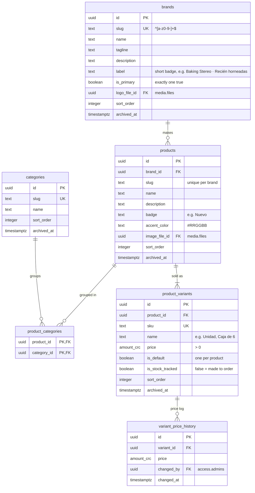

*(admin-edited: brands, categories, products, product_variants.)*

- Every product on sale has exactly one default variant (partial unique index on `product_id where is_default`; the first variant created becomes it). A product with no variants yet is not on the storefront. With one variant, the storefront shows a simple product, like today.
- Exactly one brand is primary while any is active: partial unique index on `is_primary where is_primary`, a deferrable constraint trigger that refuses none, and a check that the primary brand is not archived. `catalog.set_primary_brand(id)` swaps it atomically.
- The default variant can't be archived; `catalog.set_default_variant(id)` swaps it atomically. `catalog.set_product_categories(product_id, category_ids)` replaces a product's links.
- `logo_file_id` / `image_file_id` only reference files of purpose `brand_logo` / `product_image` (trigger `private.require_file_purpose`).
- `variant_price_history` is written by triggers `after insert` and `after update of price` (first price included, so the log answers "what did it cost on date D"), a mechanical audit concern (DB-17). Its rows are immutable: `changed_at` replaces `created_at` / `updated_at`. `product_categories` rows are added and removed, never edited, so they carry `created_at` / `created_by` only.
- Admin writes go through RLS; policies require `created_by` / `updated_by` = `auth.uid()`.
- *Design only:* `catalog.bundle_components (bundle_variant_id, component_variant_id, quantity)`.

## 6. Retail (points of sale)

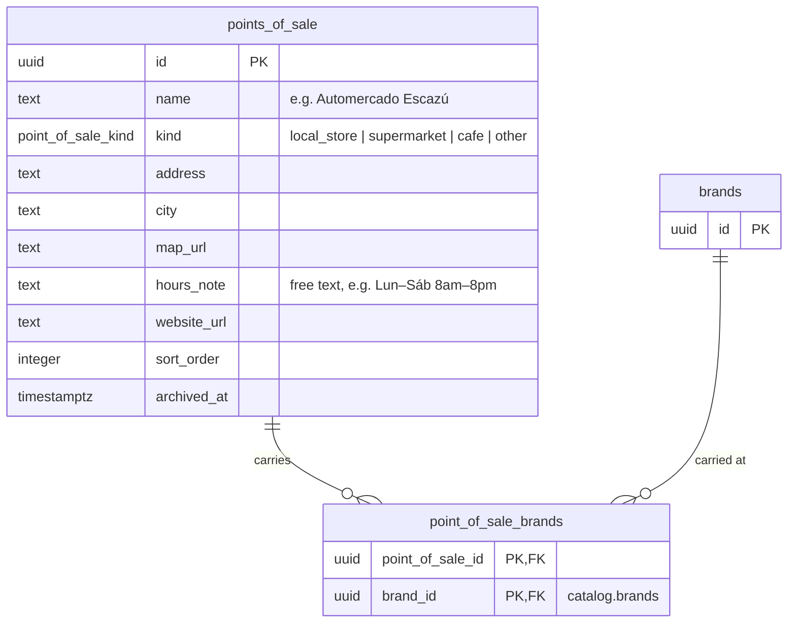

*(admin-edited: points_of_sale.)*

- Purely informational. Nothing in checkout, orders or inventory references a point of sale.
- Hours are free text on purpose: we don't run these stores and never compute with their hours.
- `point_of_sale_brands` lets the page say "Baking Stereo available here". No rows = carries the primary brand.
- *Design only:* `retail.point_of_sale_products` if per-product availability is ever needed.

## 7. Fulfillment

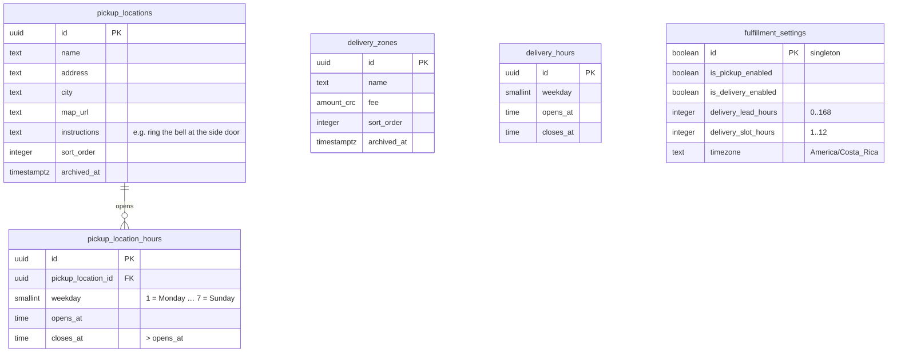

*(admin-edited: pickup_locations, delivery_zones, settings. `fulfillment_settings` is the table `fulfillment.settings`.)*

- A weekday with no hour rows is closed. Weekdays are ISO.
- Hour rows (both tables) are whole minutes with `closes_at > opens_at`, and never overlap on one weekday (per location for pickup): exclusion constraints over the range type `fulfillment.time_range(opens_at, closes_at)`, which needs `btree_gist`. Touching ranges are allowed.
- Hours are replaced as a weekly set by the invoker entry points `fulfillment.set_pickup_location_hours(location_id, hours jsonb)` and `fulfillment.set_delivery_hours(hours jsonb)`, which check `fulfillment.manage`, lock the location (or the settings row) and delete + insert in one transaction. Hour rows are never edited, so they carry `created_at` / `created_by` only. The settings singleton is created by a data migration and only updated, so it carries `updated_by` only.
- Delivery zone names are unique among active zones, ignoring case. A zone's fee may be zero (free delivery).
- `pickup_locations.map_url` is https only. `settings.timezone` is not editable by admins.
- Admin writes go through RLS; policies require `created_by` / `updated_by` = `auth.uid()`. Shoppers read active locations and zones, the hours of active locations, delivery hours and settings.
- Delivery windows are generated by a **pure TypeScript domain function** from `delivery_hours` + settings + `now`: each range is cut into back-to-back `delivery_slot_hours` windows from its opening time, for 14 days, keeping those that start at least `delivery_lead_hours` after `now` (today's rules). The Server Action re-validates the chosen window with the same function before `place_order` (ARC-04: no concurrency involved, so it lives in TS).
- Pickup has no date or window (parity). Pickup hours are shown to the customer.
- *Design only:* `fulfillment.couriers`, `fulfillment.closures (starts_on, ends_on, reason)`.

## 8. Inventory

Stock is **global by default**. A pickup location can optionally have its own stock for a variant; when it doesn't, orders draw from global stock.

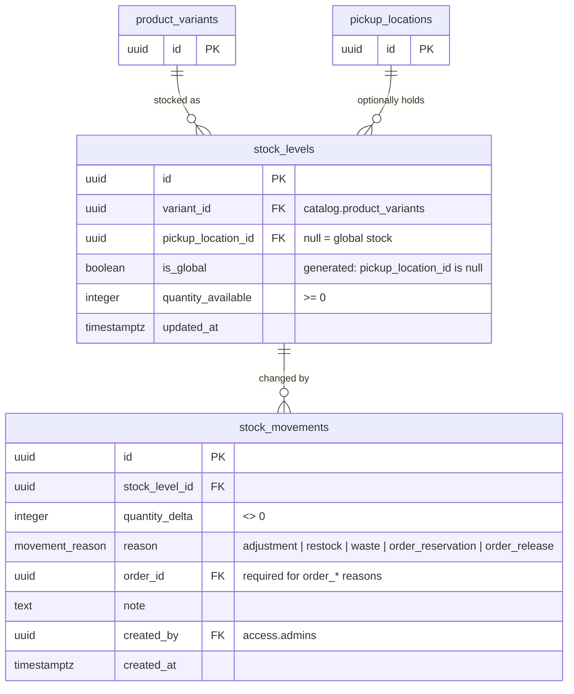

- `unique nulls not distinct (variant_id, pickup_location_id)`: at most one global row and one row per location for each variant.
- **Reservation rule**, implemented once in `private.reserve_stock(order_id)`:
  1. Variant has `is_stock_tracked = false` → no reservation (made to order).
  2. Pickup order **and** a `stock_levels` row exists for (variant, that pickup location) → reserve there.
  3. Otherwise (delivery, or a location without its own stock) → reserve from the global row.
- **Release** (reject/cancel) reverses exactly the order's `order_reservation` movements, so it never needs to re-derive where stock came from.
- `private.apply_stock_movement(variant_id, quantity, reason, pickup_location_id, admin_id, note, set_quantity)` is the **only** writer of both tables; orders will extend it with the order reference. The `quantity_available >= 0` check rejects overselling atomically. Admin "set to N" records `delta = N − current` with reason `adjustment`.
- `inventory.variant_availability(variant_ids uuid[], pickup_location_id uuid default null)` (security definer, granted to `anon`) returns `{ variant_id, is_available }` with the same rule and no quantities.

### Inventory implementation split (inventory / orders)

The inventory work item implements pool resolution and atomic movements now. Orders will add `stock_movements.order_id` with its FK and the reason/order-reference check, `private.reserve_stock`, and release by reversing original reservation rows. Until then, a check rejects both order reasons, so no unattributed reservation can enter the ledger.

The implemented writer accepts `(p_variant_id, p_quantity, p_reason, p_pickup_location_id, p_admin_id, p_note, p_set_quantity)` and returns the pool. It locks the catalog variant first, lazily creates the requested pool, and either applies a delta or computes a set-to delta under that lock. This also makes concurrent first adjustments safe. A zero initialization creates the pool without a movement; a same-target adjustment is a no-op. Missing tracked pools are unavailable. Orders can use the signed-delta path, extending the signature with the order reference in its own migration.

`inventory.adjust_stock(p_variant_id, p_quantity, p_pickup_location_id, p_note)` is the authenticated `inventory.manage` entry point; SQL supplies the actor and adjustment reason. No API role gets direct writes, including service role. Read policies grant managers quantity and ledger access; anonymous availability is boolean-only and excludes archived variants, products and brands. Stock levels carry creation/update timestamps; immutable movements carry creation time only.

Location pools can be initialized through an adjustment to zero. Disabling a pool is deferred: deleting one with historical movements would break the immutable ledger FK. A history-preserving disable design must be agreed before adding that entry point.

The storefront availability query is cached briefly and tagged with inventory and catalog; adjustments expire inventory. Checkout must re-check/reserve in SQL. Orders must invalidate inventory after reservation/release.

## 9. Orders

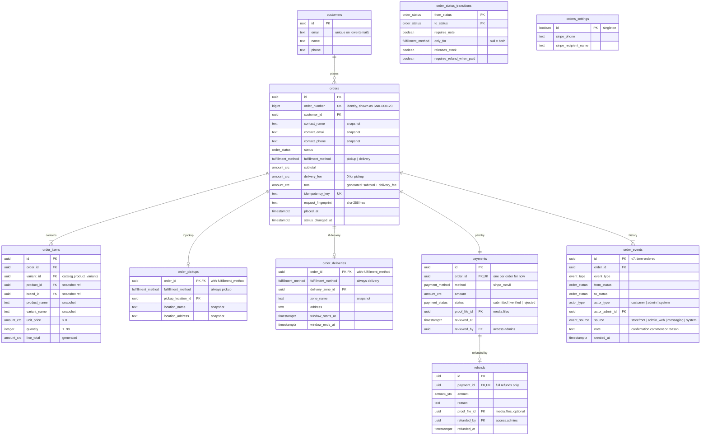

*(`orders_settings` is the table `orders.settings`.)*

### Enums

```sql
create type orders.order_status as enum (
  'pending_review',
  'confirmed',
  'ready_for_pickup',
  'out_for_delivery',
  'completed',
  'rejected',
  'cancelled'
);

create type orders.fulfillment_method as enum ('pickup', 'delivery');
create type orders.payment_method     as enum ('sinpe_movil');
create type orders.payment_status     as enum ('submitted', 'verified', 'rejected');
create type orders.actor_type         as enum ('customer', 'admin', 'system');
create type orders.event_source       as enum ('storefront', 'admin_web', 'messaging', 'system');

create type orders.event_type as enum (
  'placed',
  'status_changed',
  'payment_verified',
  'payment_rejected',
  'refund_recorded'
);
```

### Fulfillment subtypes (DB-09, class-table inheritance)

```sql
create table orders.order_pickups (
  order_id            uuid primary key,
  fulfillment_method  orders.fulfillment_method not null default 'pickup',
  pickup_location_id  uuid not null references fulfillment.pickup_locations (id),
  location_name       text not null,
  location_address    text not null,

  constraint order_pickups_method_check
    check (fulfillment_method = 'pickup'),

  constraint order_pickups_order_fkey
    foreign key (order_id, fulfillment_method)
    references orders.orders (id, fulfillment_method)
);

create table orders.order_deliveries (
  order_id            uuid primary key,
  fulfillment_method  orders.fulfillment_method not null default 'delivery',
  delivery_zone_id    uuid not null references fulfillment.delivery_zones (id),
  zone_name           text not null,
  address             text not null,
  window_starts_at    timestamptz not null,
  window_ends_at      timestamptz not null,

  constraint order_deliveries_method_check
    check (fulfillment_method = 'delivery'),

  constraint order_deliveries_address_check
    check (char_length(address) between 5 and 500),

  constraint order_deliveries_window_check
    check (window_ends_at > window_starts_at),

  constraint order_deliveries_order_fkey
    foreign key (order_id, fulfillment_method)
    references orders.orders (id, fulfillment_method)
);
```

`orders.orders` has `unique (id, fulfillment_method)` as the FK target. The composite FK makes a pickup row on a delivery order **impossible**, with no nullable columns. "Exactly one subtype row exists" is guaranteed by `place_order` (the only writer) and covered by pgTAP. A future courier = one nullable `courier_id` on `order_deliveries`.

### Other rules

- `orders`: `check (fulfillment_method = 'delivery' or delivery_fee = 0)`; index `(status, placed_at desc)` for the admin queue.
- `order_items`: `unique (order_id, variant_id)`.
- `payments`: `check (method <> 'sinpe_movil' or proof_file_id is not null)`.
- `refunds.amount = payments.amount` is enforced in `private.transition_order` (full refunds, DOM-06).
- `order_events`: `check ((actor_type = 'admin') = (actor_admin_id is not null))`; index `(order_id, id)`; no `update`/`delete` grants to anyone.
- `order_status_transitions` is reference data (`*_data.sql`) and the **single source of truth** for the state machine; the admin UI reads it to render actions. See [order lifecycle](../domain/order-lifecycle.md).

### Idempotency (DB-13)

| Operation | Mechanism | Why |
|---|---|---|
| Place order | `orders.idempotency_key unique` + fingerprint, behind an advisory xact lock | The only non-idempotent create. Storing the key on the resource makes "key exists ⇔ order exists" atomic, with no orphan keys. |
| Admin/messaging transitions | Compare-and-set on `status`; re-applying the same target is a no-op | Naturally idempotent; a key table would add nothing. |
| Webhooks | `messaging.inbound_updates (channel, external_id) unique` | The provider supplies the id. |
| Event consumers | `events.event_receipts (consumer, event_id)` + `messaging.outbound_messages.dedupe_key` (`<event_id>:<notification_type>:<identity>`) | Re-running a consumer is safe. |

If a third non-idempotent create appears, introduce `private.idempotency_keys (scope, key, fingerprint, response jsonb, expires_at)` (rule of three).

### Entry points

| Function | Callable by | Does |
|---|---|---|
| `orders.place_order(request jsonb)` | `service_role` | In one transaction: advisory lock on the idempotency key → replay, or reject on fingerprint mismatch → upsert customer → read current prices and fees → insert order, items, subtype, payment → `private.reserve_stock` → append the `placed` order event → `private.publish_event('order.placed', …)`. |
| `orders.admin_transition_order(order_id, to_status, note, refund_proof_file_id)` | `authenticated` + `orders.decide` | Resolves the admin from `auth.uid()`, calls `private.transition_order(..., source => 'admin_web')`. |
| `orders.system_transition_order(admin_id, order_id, to_status, note, refund_proof_file_id, source)` | `service_role` | Same, for the admin chat (admin resolved from their linked channel identity, permission re-checked). |
| `private.transition_order(...)` | — | Locks the row, validates against `order_status_transitions`, compare-and-set on status, updates the payment, records the refund, releases stock, appends the order event, publishes `order.status_changed`. Re-applying the current status is a no-op. |

## 10. Events, messaging, notifications & admin chat (DB-14/15)

Four small schemas, each with one job. None of them knows about orders except through event payloads and capabilities, so new event sources (stock alerts), new channels (WhatsApp) and new chat features (summaries, an AI agent) don't need schema changes here.

| Schema | Job | MVP |
|---|---|---|
| `events` | App-wide log of things that happened, readable by any consumer | ✓ |
| `messaging` | Transport: linked chat accounts, outgoing queue, incoming inbox. No business knowledge. | ✓ |
| `notifications` | Decides what to tell whom, and when: notification types, subscriptions, pause | ✓ |
| `admin_chat` | The admin panel over chat: commands and multi-step flows (confirm/reject today, summaries and an AI agent later) | ✓ (order decisions) |

**MVP use case:** an admin receives a new-order alert in Telegram and confirms or rejects it from the bot. The end-to-end flow is in [architecture §5](03-architecture.md#5-telegram-admin-bot-and-notifications).

### Events

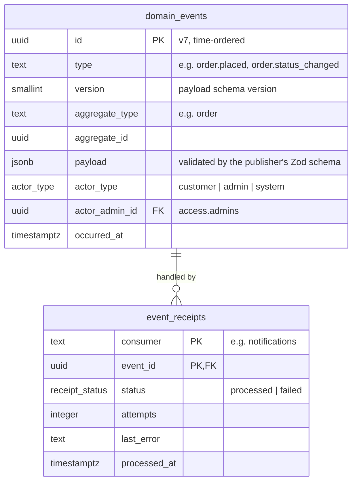

- **Transactional outbox.** Entry points publish with `private.publish_event(...)` **in the same transaction** as the change. `orders.place_order` publishes `order.placed`; `private.transition_order` publishes `order.status_changed`.
- `type` is text with a format check (`^[a-z_]+\.[a-z_]+$`), not an enum. Event types grow with features, and each publisher owns the Zod schema of its payloads (`features/<x>/domain/events.ts`).
- Payloads carry the data consumers need (event-carried state), e.g. `order.placed` includes the order number, items, total, fulfillment summary, brand ids and proof file id. Consumers don't query the publisher's tables.
- `orders.order_events` stays as the order's typed history (timeline, audit). `domain_events` is the public contract other features read.
- `events.pending_events(consumer, limit)` returns events with no receipt for that consumer, or a `failed` receipt with fewer than 5 attempts, oldest first. Receipts (not a cursor) are used because commit order can differ from id order.

### Messaging

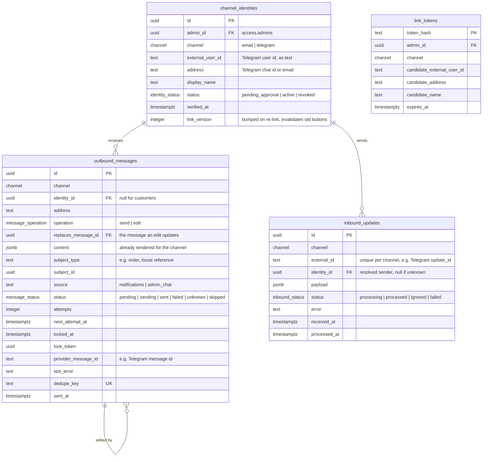

- Unique `(channel, external_user_id)` and `(admin_id, channel)` on identities. **Linking needs two steps**: the admin opens a deep link with a one-time token in the bot, then approves the candidate account on the web. A leaked token alone can't link an account.
- `content` is rendered **before** queueing (by notifications or admin chat), so messaging only delivers. For Telegram: `{ text, buttons, photo_file_id? }`. For email: `{ subject, html, text }`.
- `subject_type`/`subject_id` is a loose reference (no FK), so a later message can **edit** earlier alerts about the same order, e.g. replace the buttons with "✅ Confirmado por Ana".
- Partial index on `next_attempt_at where status in ('pending', 'failed')`; index on `(subject_type, subject_id)`.
- Entry points (`service_role`): `claim_outbound(limit)` (`for update skip locked`), `complete_outbound(...)`, `claim_inbound(channel, external_id, payload)`, `enqueue_outbound(jsonb)` (insert with `on conflict (dedupe_key) do nothing`).

### Notifications

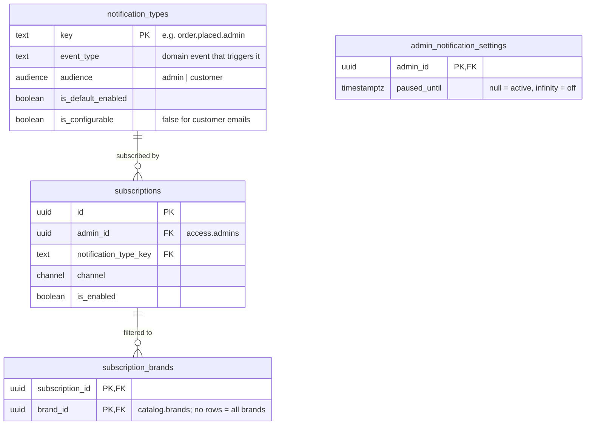

- MVP types (reference data): `order.placed.admin` (Telegram alert with Confirm/Reject buttons), `order.decided.admin` (edits the earlier alerts), `order.confirmed.customer`, `order.rejected.customer`, `order.cancelled.customer` (emails).
- Approving a Telegram link publishes `channel_identity.linked`; the notifications consumer creates that admin's default subscriptions from it.
- Recipients are admins who are subscribed, not paused, match the brand filter, and **have the permission** the message's buttons need (`orders.decide`).
- *Step 2, design only:* `digest_schedules (admin_id, digest_type, local_time, channel, last_sent_at)` for daily summaries, built by calling reporting capabilities.

### Admin chat

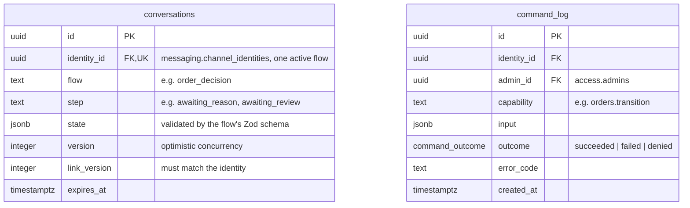

- `state` is JSON on purpose: it differs per flow, lives for minutes, and its shape is owned by code (each flow has a Zod schema and a pure state machine in `features/admin-chat/domain/flows/`).
- Every action taken from chat goes through a **capability** (see [architecture §5](03-architecture.md#5-telegram-admin-bot-and-notifications)) and is recorded in `command_log`. Order transitions are also recorded in `orders.order_events` with source `messaging`.
- *Step 3, design only:* `assistant_threads`, `assistant_messages`, `assistant_tool_calls` (agent transcripts and an audit of every tool call).

## 11. Themes & reporting

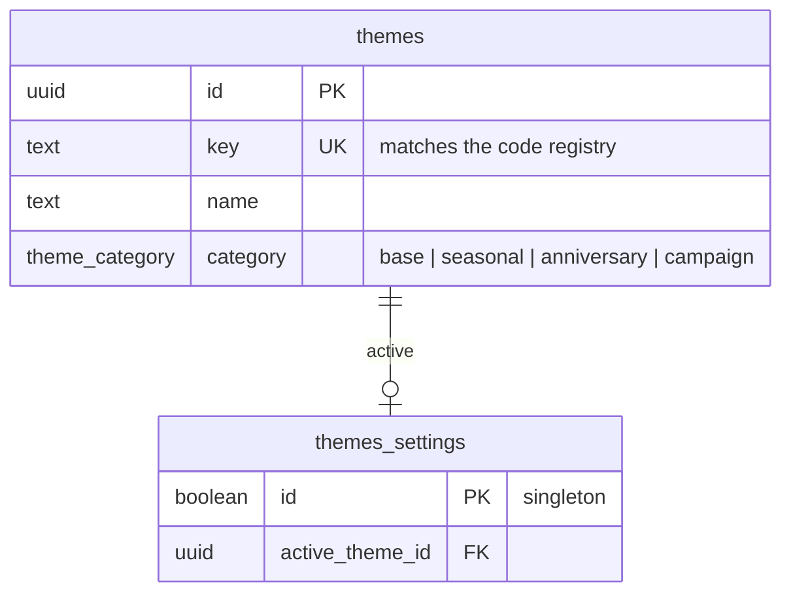

- `themes` is reference data; a unit test asserts every DB key has a code implementation and vice versa.
- *Design only:* `themes.activations (theme_id, brand_id null, starts_at, ends_at)` for scheduling and per-brand themes.
- `reporting` has no tables: `sales_by_day`, `sales_by_variant`, `sales_by_brand`, `sales_by_zone` (security definer, check `reports.view`, count orders in `confirmed | ready_for_pickup | out_for_delivery | completed`, group by `placed_at at time zone 'America/Costa_Rica'`).

## 12. Security model (DB-16)

| Role | Gets |
|---|---|
| `anon` | `select` on non-archived rows of catalog, retail, fulfillment and themes tables; column-level `select` on `orders.settings (sinpe_phone, sinpe_recipient_name)`; `execute` on `inventory.variant_availability`. |
| `authenticated` | Policies `using ((select private.has_permission('<perm>')))`. CRUD on catalog, retail, fulfillment, themes and settings via RLS. Each admin manages **their own** notification subscriptions and pause settings (`admin_id = (select auth.uid())` + `notifications.manage_own`). **No** direct writes on orders, payments, refunds, events or stock, which change only through entry points. |
| `service_role` | Entry points for checkout, events, messaging, admin chat and jobs. Used only from `features/*/server/**` after authorization. |

Every table: `enable row level security`, default privileges revoked, one pgTAP file per schema testing every policy for every role.

## 13. SQL style

SQL is read far more often than it's written. Format it like code (the old migrations' one-line `create function` blocks are what we're moving away from).

```sql
create or replace function private.reserve_stock(p_order_id uuid)
returns void
language plpgsql
security definer
set search_path = ''
as $$
declare
  v_item record;
  v_stock_level_id uuid;
begin
  for v_item in
    select
      items.variant_id,
      items.quantity,
      pickups.pickup_location_id
    from orders.order_items as items
    join catalog.product_variants as variants
      on variants.id = items.variant_id
    left join orders.order_pickups as pickups
      on pickups.order_id = items.order_id
    where items.order_id = p_order_id
      and variants.is_stock_tracked
  loop
    v_stock_level_id := private.resolve_stock_level(
      v_item.variant_id,
      v_item.pickup_location_id
    );

    perform private.apply_stock_movement(
      p_stock_level_id => v_stock_level_id,
      p_delta          => -v_item.quantity,
      p_reason         => 'order_reservation',
      p_order_id       => p_order_id
    );
  end loop;
end;
$$;
```

- Lowercase keywords; one selected column, join and condition per line; aligned named arguments (`=>`).
- Blank lines between statements and between the declare and body blocks.
- Meaningful aliases (`items`, `pickups`), never single letters.
- One function = one job (≤ ~50 lines). Extract helpers into `private` instead of growing a function.
- Prefixes: `p_` parameters, `v_` variables.
- Formatted by hand. `prettier-plugin-sql` was evaluated in the scaffold and rejected: it flattens `create function` headers and splits `grant` statements. Generated migrations use the CLI formatter (`[experimental.pgdelta] format_options`, lowercase keywords).

## 14. Migrating from today's schema (G-04)

| Today | New | Migrated? |
|---|---|---|
| `products` (text id, brand text, price, stock, image) | `catalog.brands` (2 rows), `products`, one default `product_variants` row each, a global `stock_levels` row, `media.files` for images | Yes |
| `sales_points` | `fulfillment.pickup_locations`, since checkout uses them for pickup today. Rows that are really third-party stores are re-entered by an admin as `retail.points_of_sale`. Free-text `hours` → `pickup_location_hours`. | Yes (review each row) |
| `delivery_zones` | `fulfillment.delivery_zones` | Yes |
| `store_settings` | split into `orders.settings`, `fulfillment.settings` (+ `delivery_hours` from JSONB), `themes.settings` | Yes |
| `admin_users` | `access.admins` (role `owner`) | Yes |
| `orders`, `order_items`, `email_outbox`, `order_decision_audit` | — | No (pending orders resolved before cutover) |
| `telegram_*` | — | No: admins re-link through `messaging.channel_identities` (it was WIP) |
