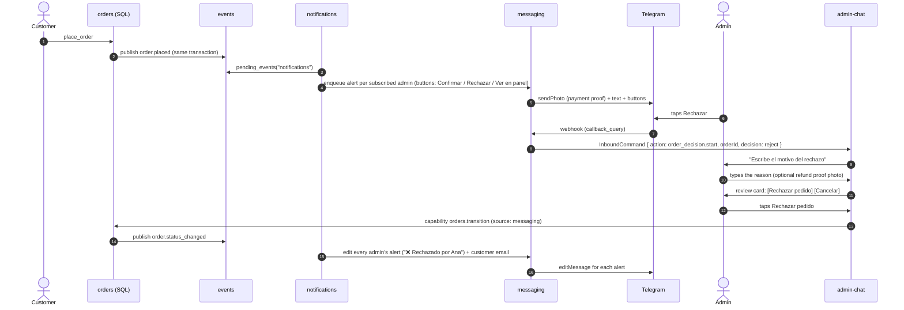
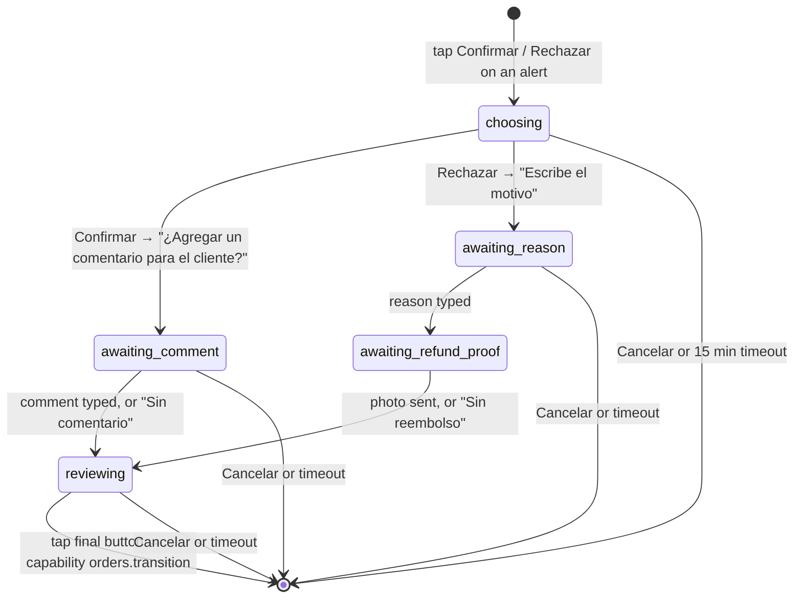

# Architecture

How the rebuilt app is put together. Decisions cited by ID from [01-decisions.md](01-decisions.md); data model in [02-er-design.md](02-er-design.md).

## 1. Runtime map

```
Browser ──► Next.js 16 on Vercel ─────────────────────────────► Supabase
            ├─ Server Components (pages, RSC data reads)          ├─ Postgres (schemas per feature, RPCs, RLS)
            ├─ Server Actions (every mutation from the UI)        ├─ Auth (admin email + password)
            ├─ Route Handlers                                     ├─ Storage (proofs, catalog images)
            │   ├─ POST /api/webhooks/[channel]  (Telegram bot)   └─ pg_cron + pg_net ──┐
            │   └─ POST /api/jobs/[job]          (cron targets) ◄──────────────────────┘
            └─ proxy.ts (optimistic /admin redirect only)
                     │
                     └──► Providers: Resend (email), Telegram Bot API
```

- **No Edge Functions** (ARC-05). One runtime (Node on Vercel), one toolchain, shared Zod schemas and types.
- The browser talks to Supabase **only for Auth** (sign-in session cookies via `@supabase/ssr`) and **direct-to-Storage uploads with a signed URL**. All data reads and writes go through Next server code.
- `proxy.ts` (Next 16's name for middleware) only redirects unauthenticated visitors away from `/admin`. It is **not** authorization; every Server Action and DAL function checks permissions itself.

## 2. Where logic lives

ARC-04 as a mechanical rule. Agents apply it top-down; the first match wins.

| # | If the logic… | It lives in | Example |
|---|---|---|---|
| 1 | must be atomic across several rows, or correct under concurrency | **SQL entry-point function** (`<schema>.<verb>_<noun>`), calling `private.*` helpers | place order, reserve stock, transition order, claim outbox rows |
| 2 | is a data-integrity rule (types, ranges, relationships, uniqueness) | **DB constraint**, *and* mirrored in a Zod schema at the boundary for friendly errors | price > 0, one default variant per product |
| 3 | decides *who may do it* | **TS DAL** (`requirePermission`) *and* RLS / a `has_permission` check in SQL (defense in depth) | staff can't edit products |
| 4 | is a pure business calculation or decision | **TS `domain/`** (no I/O, unit-tested) | delivery windows, cart totals preview, notification fan-out rules, conversation steps |
| 5 | talks to the outside world | **TS `integrations/`** adapter, called from `server/` | Resend, Telegram, Storage signed URLs |
| 6 | orchestrates 1–5 for a use case | **TS `server/` action or job** | `placeOrderAction`, `dispatchMessagesJob` |

Things that **never** happen: business rules in components, `supabase.from()` outside `server/` repositories, triggers with business side effects (DB-17), duplicate permission matrices (TS reads `access.my_permissions()`).

## 3. Anatomy of a feature

```
src/features/orders/
├─ AGENTS.md
├─ index.ts            # public API: what other features and app/ may import
├─ domain/             # pure: Zod schemas, types, rules, error codes. Imports only shared/lib and other domains' types
├─ server/             # "server-only": actions.ts, queries.ts, repository.ts, jobs.ts
├─ hooks/              # use-*.ts: client state, handlers, Server Action calls (the logic behind ui/)
└─ ui/                 # components: render only; client components marked 'use client' at the leaf
```

Data and logic flow in one direction:

```
app/page.tsx ──(server queries)──► DTO props ──► ui/Component ──► hooks/useComponent ──► server/actions ──► repository ──► SQL
                                                 (renders)        (state + handlers)     (authorize, parse, execute)
```

- **Components** (`ui/`) only render: markup, styling, accessibility, and wiring events to handlers from their hook.
- **Hooks** (`hooks/`) hold everything a component needs: state, derived values (computed by `domain/` functions), event handlers, Server Action calls with `useActionState`/`useTransition`, optimistic updates. One hook per interactive component (`OrderActions` ↔ `useOrderActions`).
- **Repository** (`server/repository.ts`): the only file that touches `supabase-js` for this feature. Takes a client, returns domain types (DTOs) parsed with Zod, never raw rows.
- **Queries** (`server/queries.ts`): read use cases for Server Components. Authorize, call the repository, return minimal DTOs (Next's Data Access Layer pattern).
- **Actions** (`server/actions.ts`): `'use server'` mutations. Every action follows the same steps:

```ts
/**
 * Confirms, rejects or advances an order.
 * @param input Raw form input; validated here.
 * @returns The updated order or a typed error code.
 */
export async function transitionOrderAction(input: unknown): Promise<ActionResult<OrderDto>> {
  return runAction("orders.transition", async (log) => {
    const context = await getAdminContext({ source: "admin_web" });

    const result = await transitionOrder.run(context, input);
    if (!result.ok) {
      return result;
    }
    log.step("transitioned", {
      orderId: result.value.id,
      toStatus: result.value.status,
    });

    updateTag(orderTags.detail(result.value.id));
    after(() => kickEventConsumers());

    return result;
  });
}
```

The steps are always the same: **authorize → parse → execute → invalidate → side effects**. For admin mutations, the first three happen inside the capability's `run` (§5.2), so the Telegram bot gets exactly the same checks. The hook that calls it:

```ts
/**
 * Exposes the actions an admin can take on one order.
 * @param order The order shown on screen.
 * @returns Allowed transitions, pending state and a handler to run one.
 */
export function useOrderActions(order: OrderDto) {
  const [isPending, startTransition] = useTransition();
  const [error, setError] = useState<OrdersErrorCode | null>(null);

  const allowedTransitions = listAllowedTransitions(order);

  function transitionTo(toStatus: OrderStatus, note?: string) {
    startTransition(async () => {
      const result = await transitionOrderAction({
        orderId: order.id,
        toStatus,
        note,
      });

      setError(result.ok ? null : result.error);
    });
  }

  return {
    allowedTransitions,
    error,
    isPending,
    transitionTo,
  };
}
```

`runAction` (in `shared/lib/actions`) assigns a correlation id, logs start/finish/duration, catches unexpected throws, logs them with the stack, and returns `err("unexpected")`. Raw errors never reach the client.

## 4. Key flows

### Checkout (place order)

1. The cart (client store over `localStorage`) holds `{variantId, quantity}` only, never prices.
2. The customer picks **pickup at a Snackyzz pickup location** or **delivery**. Points of sale (third-party stores) never appear in checkout. Delivery windows are computed by `fulfillment/domain/delivery-windows.ts` from the settings and hours the page loaded. Availability is checked with `inventory.variant_availability(variantIds, pickupLocationId)`, using the location's own stock if it has any, otherwise global stock.
3. Upload: `media` action `createProofUploadAction` → validates type/size claims → returns a signed upload URL → the browser uploads directly to the private bucket → `registerUploadAction` reads the object metadata, re-checks mime, size and pixel limits (Q-06), and inserts `media.files`.
4. `placeOrderAction`: rate-limit check → Zod-parse the request → re-validate the chosen window with the same domain function → compute the fingerprint → `orders.place_order` (service role). Prices, fees and stock are resolved **inside** the RPC from current DB values, so the client can't influence them.
5. Success page shows the order number and states that payment is **under review** (placed ≠ confirmed).

### Admin decides an order

`transitionOrderAction` → capability `orders.transition` → `orders.admin_transition_order` → `private.transition_order` (locks the row, checks the transitions table, updates payment/refund/stock, appends the order event, publishes `order.status_changed`). Alerts and emails follow asynchronously (§5).

### Admin decides from Telegram

The MVP use case. See [§5.3](#53-mvp-flow-end-to-end) for the full sequence and [§5.4](#54-the-order-decision-flow) for the flow.

## 5. Telegram admin bot and notifications

**MVP use case:** a customer places an order → every subscribed admin gets a Telegram alert → one admin taps **Confirmar** or **Rechazar** → the order changes, the alerts update for everyone, and the customer gets an email.

The design is generic on purpose. Step 2 (summaries, more commands) and step 3 (an AI agent answering admin questions) reuse the same pieces without schema changes.

### 5.1 The pieces

```
orders, inventory, … ──(same transaction)──► events.domain_events
                                                   │
                                                   ▼
                              notifications: who should hear about this event, rendered how?
                                                   │ rendered messages
                                                   ▼
               messaging: channel identities, outbound queue, inbound inbox ◄──► Telegram / Resend (email)
                                                   │ inbound commands (button taps, text, photos)
                                                   ▼
               admin-chat: flows (order decision), later commands and the AI agent
                                                   │ calls
                                                   ▼
               capabilities: admin actions defined once per feature ◄── also called by web Server Actions
```

| Feature | Owns | Knows about orders? |
|---|---|---|
| `events` | The app-wide event log and consumer receipts | No, only event envelopes |
| `messaging` | Linking chat accounts, sending, editing, receiving, retries, channel adapters | No |
| `notifications` | Notification types, subscriptions, rules mapping events → recipients → rendered content | Only through event payload types |
| `admin-chat` | Conversation flows, command routing, button callbacks | Only through capabilities |
| `orders` (and others) | Business rules; publishes events; exports capabilities | It's the owner |

Patterns: **transactional outbox** (events and outbound messages are written in the same transaction as the change), **Strategy + Registry** (one adapter per channel), **ports and adapters** (capabilities are the use cases; Server Actions, chat commands and future agent tools are three adapters on top of them).

### 5.2 Capabilities: actions defined once

A capability is an admin action with a schema, a permission and an implementation. Features export theirs from `index.ts`.

```ts
/**
 * Moves an order to another status on behalf of an admin.
 * @returns The updated order, or why the transition was refused.
 */
export const transitionOrder = defineCapability({
  name: "orders.transition",
  kind: "mutation",
  permission: "orders.decide",
  input: transitionOrderInput,

  async execute(context, input) {
    const repository = ordersRepository(context.client);

    return repository.transition({
      ...input,
      actorAdminId: context.admin.id,
      source: context.source,
    });
  },
});
```

- `defineCapability` (in `shared/lib`) checks the permission and parses the input before `execute` runs, so no front end can skip either.
- The web Server Action `transitionOrderAction` and the Telegram flow both call `transitionOrder`. One implementation, two front ends.
- `context.source` (`admin_web` | `messaging`) ends up in `orders.order_events`, so the timeline shows where each decision came from.
- MVP capabilities: `orders.get` (details for the alert and the review step), `orders.transition`.

### 5.3 MVP flow, end to end



Latency: actions call `kickEventConsumers()` inside `after()` (a POST to `/api/jobs/events`, which is the composition root that knows the consumers), so alerts usually go out within seconds. `pg_cron` runs the consumers every minute as a safety net.

### 5.4 The order-decision flow

A pure state machine in `admin-chat/domain/flows/order-decision.ts`. Its state lives in `admin_chat.conversations`.



- The review step always shows the order number, customer, total and the exact text the customer will receive. Nothing changes until the final tap.
- A refund proof photo is downloaded from Telegram, re-validated, and stored through `media` (purpose `refund_proof`), never kept as a Telegram file reference.
- One active flow per admin. Starting a new one cancels the old one, with a message saying so.

### 5.5 Linking an admin's Telegram account

1. On `/admin/notifications` the admin clicks **Vincular Telegram** → `messaging` creates a one-time token (10 min) → the page shows a `t.me/<bot>?start=<token>` link and a QR code.
2. The admin opens it and taps Start → the bot stores the Telegram account as the token's candidate.
3. The web page shows "¿Es esta tu cuenta? @ana" → the admin approves → the identity becomes `active` and `channel_identity.linked` is published; notifications creates the default subscriptions from it.

Two steps mean a leaked link can't attach someone else's Telegram to an admin. Unlinking or re-linking bumps `link_version`, which invalidates old buttons and flows.

### 5.6 Edge cases (all must have tests)

| Case | Behavior |
|---|---|
| Two admins tap at the same time | The transition is compare-and-set. The second gets "Este pedido ya fue confirmado por Ana", and their alert is edited like everyone else's. |
| Button tapped after the order was decided, or after re-linking | The callback is answered with a short notice; nothing changes. |
| Unknown Telegram user writes to the bot | Ignored, apart from one reply: "Esta cuenta no está vinculada". Logged as `ignored`. |
| Admin archived or permission removed | The capability refuses (`denied` in `command_log`). Alerts stop because recipients require the permission. |
| Telegram retries the same update | `messaging.claim_inbound` deduplicates by `update_id`; the webhook still returns 200. |
| Flow times out | Conversation expires after 15 min. The next message from the admin is treated as new. |
| Telegram is down | Outbound retries with backoff; after 5 attempts the message is `failed` and shown in admin. The order itself is unaffected. |

Callback data is `<link_version>:<flow>:<decision>:<order_id>` (≤ 64 bytes, Telegram's limit). It's never trusted on its own: the sender is resolved to an identity and the admin's permission is re-checked on every tap.

### 5.7 Channel adapters

```ts
export interface ChannelAdapter<K extends ChannelKind = ChannelKind> {
  readonly kind: K;

  /** Sends or edits one rendered message. */
  deliver(message: OutboundMessage<K>): Promise<Result<DeliveryReceipt, DeliveryError>>;

  /** Turns a provider webhook into channel-agnostic commands. */
  parseInbound(request: Request): Promise<Result<InboundCommand[], InboundError>>;
}
```

- `messaging/server/adapters/telegram.ts` and `email.ts` implement it on top of `src/integrations/{telegram,resend}`. A registry maps `ChannelKind` → adapter.
- `InboundCommand` is channel-agnostic: `button_tapped`, `text_received`, `photo_received`, `start_with_token`, `command` (`/pedidos`, later). WhatsApp would produce the same commands.
- `DeliveryError` is `retryable | permanent`. Backoff: 1 m, 5 m, 30 m, 2 h, max 5 attempts. A message stuck in `sending` for 10 min becomes `unknown` and is **not** resent automatically, to avoid duplicate customer emails.

### 5.8 Roadmap on the same design

| Step | Adds | Schema changes |
|---|---|---|
| **MVP** | Alerts, confirm/reject flow, customer emails, linking | — |
| **2: summaries & commands** | `digest_schedules` + a digest job; commands like `/pendientes`, `/resumen hoy` that call capabilities (`orders.list_pending`, `reporting.sales_summary`) | `notifications.digest_schedules` |
| **3: AI agent (post-MVP)** | Free-text questions in the bot answered by an LLM whose **tools are the capabilities** (tool schemas generated from the Zod inputs). It acts as the linked admin, so it can only see what that admin can. Read-only tools first; any mutation shows a confirm button. Every tool call is audited. | `admin_chat.assistant_threads`, `assistant_messages`, `assistant_tool_calls` |

Because permissions are enforced in each capability, the agent's access rules are code, not prompt instructions.

## 6. Jobs (ARC-06)

| Job | Schedule (pg_cron → pg_net) | Endpoint |
|---|---|---|
| Event consumers (notifications today) + outbound dispatch | every minute (also kicked from `after()`) | `POST /api/jobs/events` |
| Cleanup (expired link tokens and conversations; orphan proofs > 24 h; stuck `sending` → `unknown`) | hourly | `POST /api/jobs/cleanup` |
| *Step 2:* digests | every 15 min, sends those due | `POST /api/jobs/digests` |

Job endpoints require `Authorization: Bearer ${JOB_SECRET}` (compared in constant time) and are idempotent, so overlapping runs are safe because claims use `skip locked`.

## 7. Errors (AG-05)

```ts
type Result<T, E extends string = ErrorCode> =
  | { ok: true; value: T }
  | { ok: false; error: E; meta?: Record<string, unknown> };
```

- Expected failures (`invalid_input`, `out_of_stock`, `invalid_transition`, `payment_not_configured`, `rate_limited`, …) are `Result` errors. Each feature declares its codes in `domain/errors.ts`.
- SQL entry points raise with `errcode` values from the `P0` class and a stable message key (`raise exception using errcode = 'P0001', message = 'out_of_stock'`). Repositories map these to `Result` errors; unknown errors are rethrown.
- Error codes map to copy through next-intl (`errors.<feature>.<code>`), the one place where user-facing error text lives.
- `throw` is only for bugs and broken invariants.

## 8. Logging (AG-06)

- `shared/lib/logger.ts` writes JSON lines to stdout (Vercel captures them) with `{ level, msg, action, correlationId, ...context, durationMs }`. Swapping in a provider later only changes the transport.
- **Must log:** every Server Action start, each named step, outcome; every job run with counts; every webhook (accepted/rejected/duplicate); every send attempt with channel, status, attempt number.
- **Never log:** payment proof URLs, full emails/phones (mask as `a***@gmail.com`, `****1234`), tokens, secrets.

## 9. Caching & rendering

- `cacheComponents: true`. Public reads (catalog, points of sale, pickup locations, zones, active theme, payment details) are `'use cache'` functions with `cacheTag` (e.g. `catalog:products`, `fulfillment:zones`). They use the **anon** client without cookies.
- Admin mutations call `updateTag(tag)` for read-your-writes. Admin pages are dynamic (they read the session).
- Stock availability is never cached (short dynamic hole).

## 10. i18n (DOM-16)

- next-intl, single locale `es-CR`, **no locale prefix** in URLs for now.
- Messages: `src/i18n/messages/es-CR/<namespace>.json`, one namespace per feature plus `common` and `errors`. Adding a locale = a new folder + adding it to `src/i18n/config.ts`.
- Money via `format.number(amount, { style: "currency", currency: "CRC", maximumFractionDigits: 0 })`; dates in `America/Costa_Rica`.
- No hard-coded user-facing strings in components (lint rule).

## 11. Auth & sessions (Q-05)

- Supabase Auth email + password; `@supabase/ssr` cookie sessions.
- `access/server/session.ts` → `getAdmin()` (React `cache`d per request): user → `access.admins` row (not archived) → permissions from `access.my_permissions()` → enforces the 7-day absolute and 24 h inactivity limits if the Supabase plan doesn't.
- `requirePermission(p)` is the first line of every admin action/query.

## 12. UI system (ARC-10/11, Q-09)

- Tailwind v4; tokens from `DESIGN.md` go in `src/styles/tokens.css` (`@theme`): brand palette (`--color-cream #F9EDE0`, `--color-cocoa #3C1907`, `--color-orange #ED781A`, `--color-orange-deep #D95907`), type scale, radii, spacing.
- shadcn/ui components are generated into `src/shared/ui/` and restyled with tokens. Feature UI composes them and never restyles them ad hoc.
- Themes (`features/themes`) override a documented subset of tokens through a `data-theme` attribute on `<html>`; components never check the active theme.
