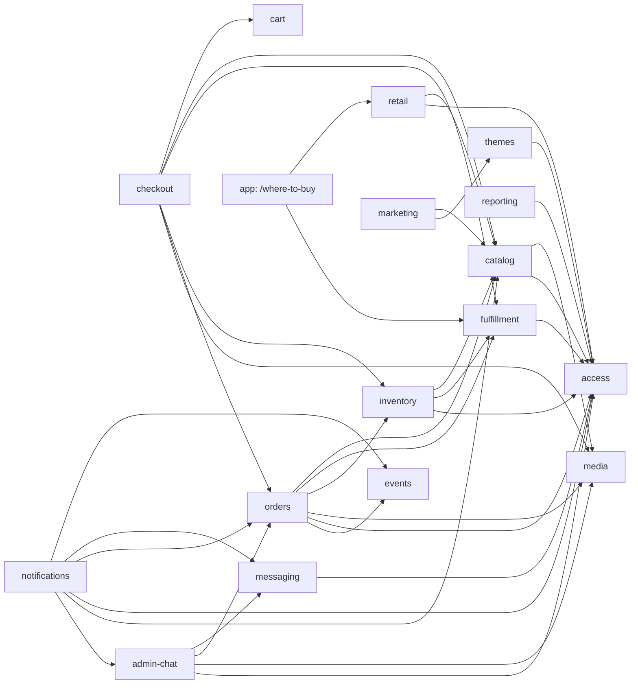

# Directory Structure

The target tree for the rebuild repo (DIR-01). Every directory marked 📄 has an `AGENTS.md` (DIR-04). On the `rework` branch (G-08) these files live at their final paths; directories that don't exist yet get created by the work item that needs them.

```
/
├─ AGENTS.md 📄                # root rules for every agent (single source)
├─ CLAUDE.md                   # contains only: @AGENTS.md
├─ README.md                   # for humans: setup, scripts, links
├─ .github/
│  ├─ pull_request_template.md
│  └─ workflows/ci.yml         # typecheck → lint → format → unit → build (Q-01)
├─ .husky/                     # pre-commit (lint-staged), commit-msg (commitlint), pre-push (typecheck + unit) (Q-02)
├─ docs/ 📄
│  ├─ adr/                     # 0001-*.md decision records (AG-11)
│  ├─ domain/                  # glossary.md, order-lifecycle.md, business rules
│  └─ rebuild/                 # questionnaire, decisions, ER design, architecture (this folder)
├─ src/
│  ├─ app/ 📄                   # Next routes only; thin pages that compose features
│  │  ├─ (store)/              #   /, /shop, /brands/[slug], /where-to-buy, /about, /checkout, /orders/[number]/placed
│  │  ├─ (admin)/admin/        #   /admin/orders, /admin/catalog, /admin/inventory, /admin/fulfillment, /admin/points-of-sale,
│  │  │                        #   /admin/settings, /admin/notifications, /admin/team, /admin/reports, /admin/sign-in
│  │  ├─ api/
│  │  │  ├─ webhooks/[channel]/route.ts
│  │  │  └─ jobs/[job]/route.ts
│  │  ├─ layout.tsx · not-found.tsx · global-error.tsx
│  ├─ features/ 📄
│  │  ├─ access/ 📄             # admin auth, sessions, roles, permissions, team management
│  │  ├─ catalog/ 📄            # brands, categories, products, variants, price history
│  │  ├─ cart/ 📄               # client cart store (no server state)
│  │  ├─ checkout/ 📄           # checkout form + placeOrder orchestration (owns no tables)
│  │  ├─ orders/ 📄             # orders, payments, refunds, lifecycle, admin queue
│  │  ├─ fulfillment/ 📄        # Snackyzz pickup locations + hours, delivery zones, delivery windows
│  │  ├─ retail/ 📄             # points of sale: third-party stores that carry Snackyzz (informational)
│  │  ├─ inventory/ 📄          # global + optional per-pickup-location stock, movements, reservation rule
│  │  ├─ events/ 📄             # app-wide domain event log, consumer runner
│  │  ├─ messaging/ 📄          # channel identities + linking, outbound queue, inbound inbox, channel adapters
│  │  ├─ notifications/ 📄      # notification types, subscriptions, event → message rules, templates
│  │  ├─ admin-chat/ 📄         # Telegram admin bot: flows (order decision), commands, later the AI agent
│  │  ├─ themes/ 📄             # theme registry, active theme
│  │  ├─ media/ 📄              # uploads, file metadata, signed URLs
│  │  ├─ reporting/ 📄          # sales reports (SQL functions + admin UI)
│  │  └─ marketing/ 📄          # home/about content sections (owns no tables)
│  │     # every feature: index.ts · domain/ · server/ (incl. capabilities.ts) · hooks/ · ui/ (create only what you need)
│  ├─ shared/ 📄
│  │  ├─ ui/                   # shadcn primitives, restyled with tokens
│  │  ├─ lib/                  # result, logger, run-action, money, dates, errors, ids
│  │  └─ config/               # env.server.ts, env.public.ts (Zod-validated)
│  ├─ integrations/ 📄
│  │  ├─ supabase/             # server-client, anon-client, service-client, browser-client, database.types.ts (generated)
│  │  ├─ resend/               # email transport
│  │  └─ telegram/             # Bot API client (HTTP only, no business logic)
│  ├─ i18n/ 📄
│  │  ├─ config.ts · request.ts
│  │  └─ messages/es-CR/*.json # one namespace per feature + common + errors
│  ├─ styles/
│  │  ├─ globals.css           # @import "tailwindcss"; base layer
│  │  └─ tokens.css            # @theme tokens from DESIGN.md
│  └─ proxy.ts                 # optimistic /admin redirect only
├─ supabase/ 📄
│  ├─ config.toml
│  ├─ schemas/                 # declarative, ordered: 00_extensions, 01_private, 10_access, 20_catalog …
│  │  └─ <schema>/             #   one file per table / function / policy group
│  ├─ migrations/              # generated by `supabase db diff`; *_data.sql are the only hand-written ones
│  ├─ tests/                   # pgTAP: <schema>.test.sql
│  └─ seed.sql                 # deterministic demo data
├─ tests/ 📄
│  ├─ e2e/                     # Playwright journeys
│  └─ fixtures/                # shared test images, factories
└─ public/                     # static assets (fonts, favicons, hero images)
```

## Import rules (DIR-02)

Enforced by `eslint-plugin-boundaries`. An agent that needs to break a rule stops and asks (AG-10).

| From ↓ may import → | `app` | `features/x` (same) | `features/y/index.ts` | `features/y/*` (deep) | `shared` | `integrations` | `i18n` |
|---|---|---|---|---|---|---|---|
| `app` | ✓ | via `index.ts` | ✓ | ✗ | ✓ | ✗ | ✓ |
| `features/x/domain` | ✗ | domain only | types only | ✗ | `lib` only | ✗ | ✗ |
| `features/x/server` | ✗ | ✓ | ✓ | ✗ | ✓ | ✓ | ✓ |
| `features/x/hooks` | ✗ | domain + server actions | ✓ (hooks + types) | ✗ | `lib` only | ✗ | ✓ |
| `features/x/ui` | ✗ | hooks + domain **types** (no server actions) | ✓ (UI + types) | ✗ | ✓ | ✗ | ✓ |
| `shared` | ✗ | ✗ | ✗ | ✗ | ✓ | ✗ | `lib` ✗ / `ui` ✓ |
| `integrations` | ✗ | ✗ | ✗ | ✗ | `lib`, `config` | ✓ | ✗ |

Rules of thumb:
- **`domain/` is pure.** No `fetch`, no Supabase, no `next/*`, no `process.env`, no `Date.now()` without injection. If it's hard to unit-test, it doesn't belong in `domain/`.
- **Features talk through `index.ts`**, and prefer calling another feature's server function over reading its tables. Exception: SQL entry points may join across schemas for reads (e.g. `place_order` reads catalog prices).
- **Components render, hooks decide.** `ui/` may not import Server Actions or call `fetch`; it gets state and handlers from its hook in `hooks/`.
- **`integrations/` knows nothing about the business.** It wraps a vendor SDK/HTTP API with typed inputs and outputs. Business decisions about *when* and *what* to send live in features.

## Feature dependency graph

Arrows = "may import from". Keep it acyclic; a cycle means a concept is in the wrong feature.



Route Handlers in `app/api` are the composition root: they pass consumers and inbound handlers into `events` and `messaging`, so those never import the features that use them. `orders` depends on neither `notifications` nor `admin-chat`. Notifications consumes events; admin-chat calls `orders` capabilities (see [architecture §5](03-architecture.md#5-telegram-admin-bot-and-notifications)). `notifications → orders` and `admin-chat → orders` import only types, event payload schemas and capabilities from `orders/index.ts`.

## Naming (DIR-07)

| Thing | Convention | Example |
|---|---|---|
| Files & folders | `kebab-case` | `delivery-windows.ts` |
| React components | `PascalCase` export, file in kebab-case | `order-card.tsx` → `export function OrderCard` |
| Hooks | `use-*.ts` in `hooks/`, named after the component they serve | `checkout-form.tsx` ↔ `use-checkout-form.ts` |
| Server Actions | `<verb><Noun>Action` in `server/actions.ts` | `transitionOrderAction` |
| Queries | `get<Noun>` / `list<Nouns>` in `server/queries.ts` | `listPendingOrders` |
| Zod schemas | `<noun>Schema` / `<verb><Noun>Input` | `placeOrderInput` |
| Tests | `<file>.test.ts(x)` next to the file; `*.int.test.ts` for tests hitting local Supabase | `delivery-windows.test.ts` |
| SQL entry points | `<schema>.<verb>_<noun>` | `orders.place_order` |
| Capabilities | `<feature>.<verb>` name, `camelCase` export in `server/capabilities.ts` | `orders.transition` → `transitionOrder` |
| Domain events | `<aggregate>.<past_tense>` + version | `order.placed` v1 |
| Route folders | English, kebab-case (ARC-03) | `app/(store)/shop` |
